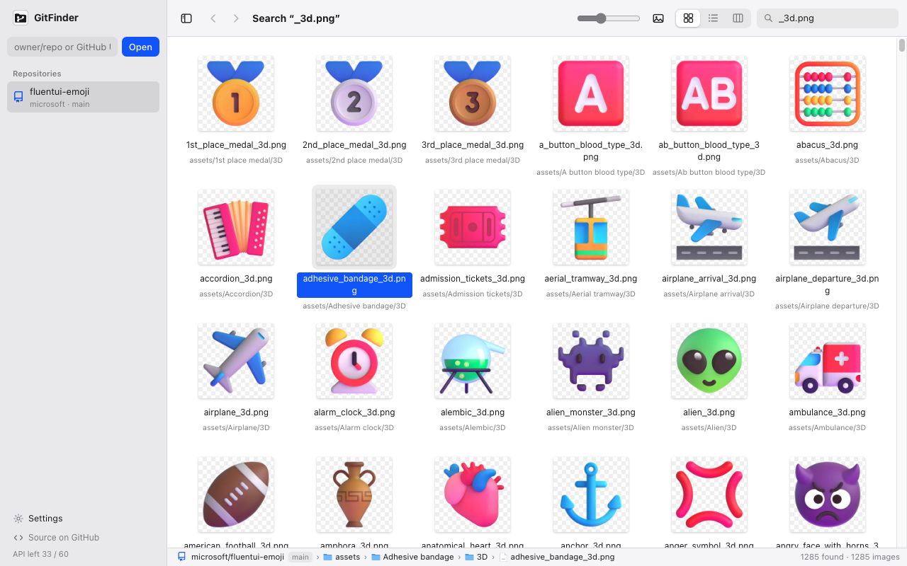
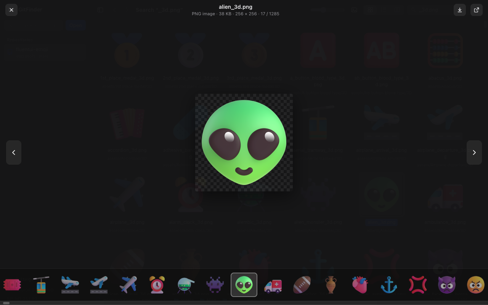
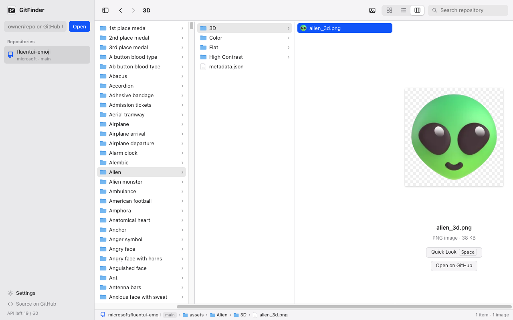

# GitFinder

**Browse any public GitHub repository like a desktop file manager.**
Paste a repository URL to get icon, list, and column views, search across the whole repository, and preview images with the Space bar.

**Live: [gitfinder.souseha.com](https://gitfinder.souseha.com)** · Try [microsoft/fluentui-emoji](https://gitfinder.souseha.com/microsoft/fluentui-emoji/tree/main/assets) · [繁體中文](README.zh-TW.md)



| Quick Look | Column view |
|---|---|
|  |  |

- No backend, no build step, no sign-in: a static page that talks to GitHub straight from your browser.
- Loads the entire file tree in one or two API calls, so moving between folders and searching costs nothing extra.

## Features

- **Three views**: icons (adjustable size), list (expandable folders), and columns (with a preview pane).
- **Fast with huge folders**: icon and list views only render what's on screen, so folders with tens of thousands of files scroll smoothly.
- **Quick Look**: press <kbd>Space</kbd> for a full-size preview, a thumbnail strip along the bottom, and arrow-key navigation. Text files open as plain text.
- **Search**: search file names across the whole repository. Separate terms with spaces; a term containing `/` matches the full path.
- **Images only**: hide everything except images and the folders that contain them.
- **Commit view**: open a single commit to see only the files it changed, tagged added, removed, renamed, or modified. Filter by status (renamed files count as modified; "Added" + Images only shows the new images), see removed images from the previous version, and compare modified images side by side in Quick Look. Switch from **By folder** to **Flat** to flatten the whole commit into one grid, with each file's folder underneath and modified images shown before and after in the same tile.
- **Pull request view**: open a pull request to see the files it changes in the same view. The before side is the merge base, the same comparison GitHub shows, and the bar shows the PR number, title, and whether it is open, merged, or closed. Pull requests from forks work too.
- **Multi-select**: <kbd>⌘</kbd>/<kbd>Ctrl</kbd>-click, <kbd>Shift</kbd>-click, <kbd>Shift</kbd>+arrows, <kbd>⌘</kbd><kbd>A</kbd>, and marquee selection by dragging on empty space (in every view).
- **Downloads**: download a single file, or zip a folder or any selection right in the browser, keeping the folder structure.
- **Context menus**: right-click files, folders, empty space, the path bar, the sidebar, or Quick Look to open, download, copy a name, path, image, or link, and more.
- **Sidebar**: remembers every repository you open and where you were. Drag to reorder; nothing is removed unless you remove it. Collapse it for more room.
- **Settings**: light, dark, or system theme; English or Traditional Chinese; optional GitHub token.
- **GitHub-style URLs**: replace `github.com` in any GitHub link with your GitFinder host to open the same place.

## Getting started

```bash
pnpm install
pnpm dev        # http://localhost:5178
```

`pnpm dev` only starts a static file server ([`serve`](https://github.com/vercel/serve)) in single-page mode; the app has no build step or dependencies of its own. Any static server works if it serves `index.html` for unknown paths.

### Opening a repository

Any of these work in the input box:

```
owner/repo
https://github.com/owner/repo
https://github.com/owner/repo/tree/branch/path/to/folder
https://github.com/owner/repo/blob/branch/path/to/file.png
https://github.com/owner/repo/commit/<sha>   (.patch and .diff links work too)
https://github.com/owner/repo/pull/<number>  (/files and other tabs work too)
```

App URLs mirror GitHub's, so you can swap the host on any GitHub link:

```
https://github.com/microsoft/fluentui-emoji/tree/main/assets
https://your-host/microsoft/fluentui-emoji/tree/main/assets
```

Branch names containing `/` work too: GitFinder checks the default branch first, then tries the shortest matching branch name. Older links in the form `/#repo=owner/repo&ref=main&path=…` still open and are rewritten to the new format.

## Keyboard shortcuts

| Key | Action |
|---|---|
| <kbd>Space</kbd> | Quick Look (press again or <kbd>Esc</kbd> to close) |
| Arrow keys | Move selection; in Quick Look, previous / next |
| <kbd>Shift</kbd> + arrow keys | Extend selection |
| <kbd>Enter</kbd> / <kbd>⌘</kbd><kbd>↓</kbd> | Open folder |
| <kbd>⌫</kbd> / <kbd>⌘</kbd><kbd>↑</kbd> | Go to enclosing folder |
| <kbd>⌘</kbd><kbd>[</kbd> / <kbd>⌘</kbd><kbd>]</kbd> | Back / forward |
| <kbd>⌘</kbd><kbd>A</kbd> | Select all |
| <kbd>⌘</kbd><kbd>C</kbd> | Copy names of selected items |
| <kbd>/</kbd> or <kbd>⌘</kbd><kbd>F</kbd> | Search |
| <kbd>1</kbd> <kbd>2</kbd> <kbd>3</kbd> | Icon / list / column view |
| <kbd>Esc</kbd> | Clear search or selection |
| <kbd>⌥</kbd><kbd>⌘</kbd><kbd>S</kbd> | Show / hide the sidebar |

On Windows and Linux, use <kbd>Ctrl</kbd> in place of <kbd>⌘</kbd> and <kbd>Alt</kbd> in place of <kbd>⌥</kbd>.

## Tests

```bash
pnpm test           # unit + end-to-end
pnpm test:unit      # Vitest: URL parsing, tree building, search, layout math, zip contents
pnpm test:e2e       # Playwright: open, browse, Quick Look, multi-select, downloads
pnpm coverage       # unit test coverage report
```

End-to-end tests run against a local server with GitHub, image, and CDN requests mocked, so they need no network and don't use your API quota. Install the browser once with `pnpm exec playwright install chromium`.

## Deploying

The app is plain HTML, CSS, and JavaScript. `pnpm build` copies the site into `dist/`; deploy that folder at the root of a domain (for example `gitfinder.example.com`, not `user.github.io/gitfinder/`).

### Cloudflare (included)

```bash
cp wrangler.example.jsonc wrangler.jsonc   # set your own domain in "routes"
pnpm run deploy                            # builds dist/ and runs wrangler deploy
```

`wrangler.jsonc` is git-ignored, so your domain and account setup stay local. The example config serves only `dist/`, returns `index.html` for unknown paths, and turns off the `<account>.workers.dev` and preview URLs so the site is reachable only on your custom domain.

### Other hosts

Because every repository path is handled by the app, the host must serve `index.html` for paths that don't match a file:

| Host | Setup |
|---|---|
| Netlify | Add a `_redirects` file containing `/* /index.html 200`. |
| Vercel | Add a `vercel.json` with `{ "rewrites": [{ "source": "/(.*)", "destination": "/index.html" }] }`. |
| GitHub Pages | Not supported without workarounds, since Pages can't rewrite paths. |

## How it works

| Need | Source |
|---|---|
| File tree | GitHub REST API, `GET /repos/{owner}/{repo}/git/trees/{ref}?recursive=1` (one request per repository) |
| Full-size files | `raw.githubusercontent.com` |
| Thumbnails | Resized to WebP by the free [wsrv.nl](https://wsrv.nl) image proxy, falling back to the raw file if the proxy fails. SVG, ICO, and images under 20 KB skip the proxy. |
| Zip downloads | [fflate](https://github.com/101arrowz/fflate), loaded from jsDelivr the first time you download a folder |

Every request goes directly from your browser to these services. GitFinder has no server of its own.

## Limits and privacy

- **Rate limit**: without a token, the GitHub API allows 60 requests per hour per IP address. Opening a repository uses one or two. Branches you have opened are kept in the browser: reopening one within 30 minutes costs nothing, and after that a single request checks for a new commit and reuses the saved file tree if there is none. To see the latest content right away, choose "Reload from GitHub" from the context menu. To raise the limit to 5,000, add a [personal access token](https://github.com/settings/personal-access-tokens/new) in Settings; public repositories need no scopes. The token is stored in plain text in your browser's `localStorage` and is sent only to `api.github.com`.
- **Very large repositories**: GitHub truncates tree responses above roughly 100,000 entries or 7 MB. GitFinder shows a warning when that happens.
- **Thumbnails go through a third party**: the URL of each image you view is sent to wsrv.nl.
- **Private repositories**: the file tree loads with a token, but images and downloads do not, because `raw.githubusercontent.com` is not authorized.
- **Git LFS**: files stored with Git LFS appear as their small pointer files.
- **Zip size**: a zip is built in browser memory. Downloads over 300 MB ask for confirmation first.

## Project structure

```
index.html          Page markup
styles.css          All styles, with light and dark color tokens
js/
  i18n.js           Translations and t()
  util.js           Helpers, icons, localStorage wrapper
  github.js         URL parsing, GitHub API, raw and thumbnail URLs
  tree.js           Builds the folder tree, search, list flattening
  virtual.js        Virtual scrolling: layout math and on-screen rendering
  views.js          HTML for icon, list, and column views and the home page
  quicklook.js      Quick Look overlay
  download.js       File and zip downloads
  app.js            State, rendering, navigation, selection
  actions.js        Download progress and clipboard actions
  contextmenu.js    Context menus
  marquee.js        Drag-to-select
  tooltip.js        Fast tooltips
  settings.js       Settings dialog
  events.js         Mouse, keyboard, and startup
tests/
  unit/             Vitest unit tests
  e2e/              Playwright end-to-end tests (mocked GitHub)
```

Each module is a plain `<script>` (no bundler, no ES modules) that registers itself on `window.GF`, so the load order in `index.html` matters.

## License

[MIT](LICENSE) © souseha
