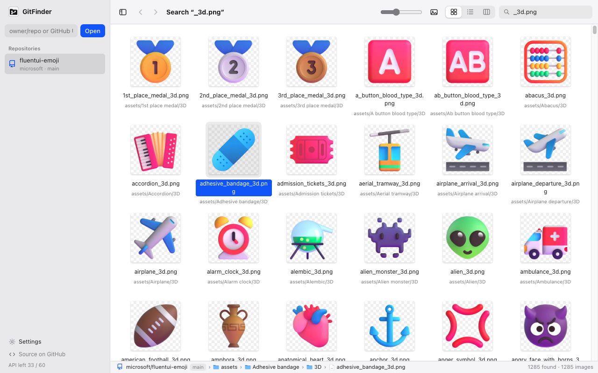
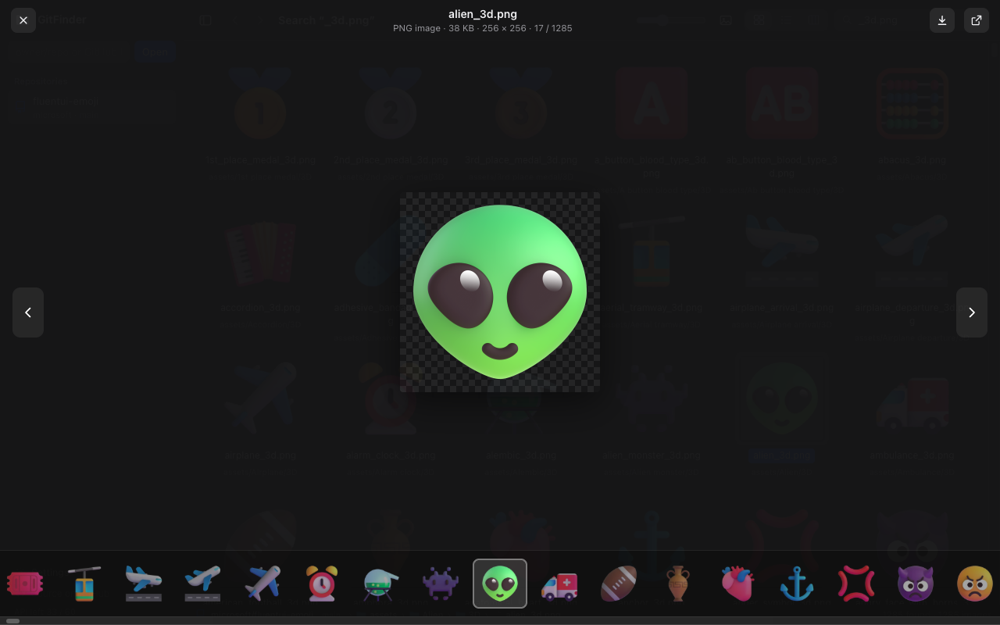
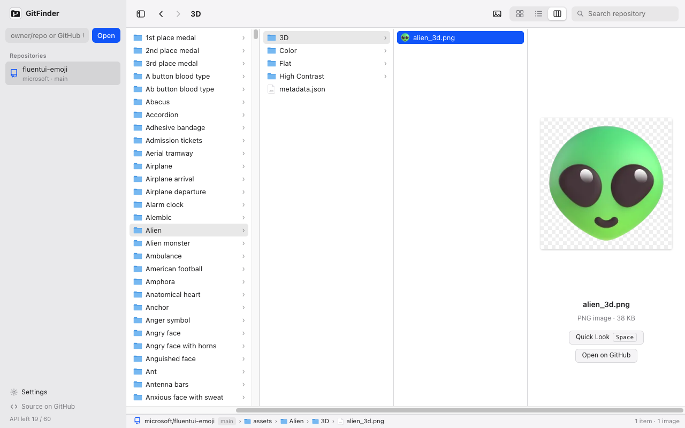

# GitFinder

**像桌面檔案管理員一樣，瀏覽任何公開的 GitHub 倉庫。**
貼上倉庫網址，就能用圖像、列表、直欄三種方式瀏覽，搜尋整個倉庫的檔案，按空白鍵預覽圖片。

**線上版：[gitfinder.souseha.com](https://gitfinder.souseha.com)** · 試試 [microsoft/fluentui-emoji](https://gitfinder.souseha.com/microsoft/fluentui-emoji/tree/main/assets) · [English](README.md)



| 快速查看 | 直欄檢視 |
|---|---|
|  |  |

- 不需要後端、不需要建置、不需要登入：純靜態網頁，由瀏覽器直接向 GitHub 取資料。
- 一次 API 請求就載入整棵檔案樹，之後切換資料夾與搜尋都不會再消耗額度。

## 功能

- **三種檢視**：圖像（可調整大小）、列表（資料夾可展開）、直欄（附預覽欄）。
- **大資料夾也流暢**：圖像與列表檢視只畫出畫面上看得到的項目，上萬個檔案的資料夾也能順暢捲動。
- **快速查看**：按 <kbd>Space</kbd> 開啟大圖預覽，底部有縮圖列，方向鍵可以切換。文字檔會直接顯示內容。
- **搜尋**：搜尋整個倉庫的檔名。用空白分隔多個關鍵字；含 `/` 的關鍵字會比對完整路徑。
- **只顯示圖片**：隱藏圖片以外的檔案，以及沒有圖片的資料夾。
- **多選**：<kbd>⌘</kbd>/<kbd>Ctrl</kbd> + 點擊、<kbd>Shift</kbd> + 點擊、<kbd>Shift</kbd> + 方向鍵、<kbd>⌘</kbd><kbd>A</kbd>，以及在空白處拖曳框選（三種檢視都支援）。
- **下載**：下載單一檔案，或在瀏覽器內把資料夾、多個選取項目打包成 zip，並保留資料夾結構。
- **右鍵選單**：在檔案、資料夾、空白處、路徑列、側邊欄或快速查看上按右鍵，可以打開、下載、複製名稱／路徑／圖片／連結等。
- **側邊欄**：記住每個開過的倉庫與最後停留的位置。可以拖曳調整順序，除非自己移除，否則不會消失。也可以收合，騰出更多空間。
- **設定**：淺色／深色／跟隨系統主題、繁體中文／英文介面、可選的 GitHub Token。
- **與 GitHub 相同的網址**：把任何 GitHub 連結裡的 `github.com` 換成 GitFinder 的網域，就會打開同一個位置。

## 開始使用

```bash
pnpm install
pnpm dev        # http://localhost:5178
```

`pnpm dev` 只是以單頁模式啟動一個靜態檔案伺服器（[`serve`](https://github.com/vercel/serve)）；這個 App 本身不需要建置，也沒有任何相依套件。換成其他靜態伺服器也可以，只要找不到檔案的路徑會回傳 `index.html`。

### 開啟倉庫

輸入框接受以下任一種格式：

```
owner/repo
https://github.com/owner/repo
https://github.com/owner/repo/tree/branch/path/to/folder
https://github.com/owner/repo/blob/branch/path/to/file.png
```

App 的網址結構和 GitHub 一樣，只要換掉網域就能互通：

```
https://github.com/microsoft/fluentui-emoji/tree/main/assets
https://your-host/microsoft/fluentui-emoji/tree/main/assets
```

分支名稱含 `/` 也沒問題：GitFinder 會先比對預設分支，再由短到長嘗試，找出實際存在的分支。舊格式 `/#repo=owner/repo&ref=main&path=…` 的連結仍然可以打開，並會自動換成新網址。

## 鍵盤快捷鍵

| 按鍵 | 功能 |
|---|---|
| <kbd>Space</kbd> | 快速查看（再按一次或 <kbd>Esc</kbd> 關閉） |
| 方向鍵 | 移動選取；快速查看中切換上一個／下一個 |
| <kbd>Shift</kbd> + 方向鍵 | 擴大選取範圍 |
| <kbd>Enter</kbd> / <kbd>⌘</kbd><kbd>↓</kbd> | 開啟資料夾 |
| <kbd>⌫</kbd> / <kbd>⌘</kbd><kbd>↑</kbd> | 回到上一層資料夾 |
| <kbd>⌘</kbd><kbd>[</kbd> / <kbd>⌘</kbd><kbd>]</kbd> | 上一頁／下一頁 |
| <kbd>⌘</kbd><kbd>A</kbd> | 全選 |
| <kbd>⌘</kbd><kbd>C</kbd> | 複製選取項目的名稱 |
| <kbd>/</kbd> 或 <kbd>⌘</kbd><kbd>F</kbd> | 搜尋 |
| <kbd>1</kbd> <kbd>2</kbd> <kbd>3</kbd> | 圖像／列表／直欄檢視 |
| <kbd>Esc</kbd> | 清除搜尋或選取 |
| <kbd>⌥</kbd><kbd>⌘</kbd><kbd>S</kbd> | 顯示／隱藏側邊欄 |

Windows 與 Linux 請用 <kbd>Ctrl</kbd> 代替 <kbd>⌘</kbd>、<kbd>Alt</kbd> 代替 <kbd>⌥</kbd>。

## 測試

```bash
pnpm test           # 單元測試 + 端對端測試
pnpm test:unit      # Vitest：網址解析、檔案樹、搜尋、版面計算、zip 內容
pnpm test:e2e       # Playwright：開倉庫、瀏覽、快速查看、多選、下載
pnpm coverage       # 單元測試覆蓋率報告
```

端對端測試在本機伺服器上執行，GitHub、圖片與 CDN 的請求都是模擬的，不需要網路，也不會消耗 API 次數。第一次請先執行 `pnpm exec playwright install chromium` 安裝瀏覽器。

## 部署

整個 App 只有 HTML、CSS 和 JavaScript。`pnpm build` 會把網站檔案複製到 `dist/`，把這個資料夾部署在網域的根目錄即可（例如 `gitfinder.example.com`，而不是 `帳號.github.io/gitfinder/`）。

### Cloudflare（已內建設定）

```bash
cp wrangler.example.jsonc wrangler.jsonc   # 在 "routes" 填入自己的網域
pnpm run deploy                            # 建置 dist/ 並執行 wrangler deploy
```

`wrangler.jsonc` 已被 `.gitignore` 排除，網域與帳號相關設定只會留在本機。範例設定只上傳 `dist/`、未知路徑回傳 `index.html`，並關閉 `<帳號>.workers.dev` 與預覽網址，網站只能從自訂網域進入。

### 其他主機

因為所有倉庫路徑都由 App 自己處理，主機必須在找不到檔案時回傳 `index.html`：

| 主機 | 設定 |
|---|---|
| Netlify | 新增 `_redirects` 檔案，內容為 `/* /index.html 200`。 |
| Vercel | 新增 `vercel.json`：`{ "rewrites": [{ "source": "/(.*)", "destination": "/index.html" }] }`。 |
| GitHub Pages | 不支援路徑改寫，需要額外的變通做法，不建議。 |

## 運作方式

| 用途 | 來源 |
|---|---|
| 檔案樹 | GitHub REST API：`GET /repos/{owner}/{repo}/git/trees/{ref}?recursive=1`（每個倉庫一次請求） |
| 原始檔案 | `raw.githubusercontent.com` |
| 縮圖 | 透過免費圖片代理 [wsrv.nl](https://wsrv.nl) 縮小並轉成 WebP，代理失敗時改用原圖。SVG、ICO 與 20 KB 以下的小圖不經過代理。 |
| zip 打包 | [fflate](https://github.com/101arrowz/fflate)，第一次下載資料夾時才從 jsDelivr 載入 |

所有請求都是從你的瀏覽器直接送到上述服務，GitFinder 沒有自己的伺服器。

## 限制與隱私

- **API 次數上限**：沒有 Token 時，GitHub API 每個 IP 每小時只能呼叫 60 次，開一個倉庫會用掉 1～2 次。在「設定」加入 [Personal Access Token](https://github.com/settings/personal-access-tokens/new) 可以提高到 5000 次，公開倉庫不需要勾任何權限。Token 以明文存在瀏覽器的 `localStorage`，只會送到 `api.github.com`。
- **超大倉庫**：檔案超過約 10 萬個或回應超過 7 MB 時，GitHub 只會回傳部分檔案樹，GitFinder 會顯示警告。
- **縮圖會經過第三方**：你瀏覽的每張圖片網址都會送到 wsrv.nl。
- **私有倉庫**：有 Token 時可以載入檔案樹，但圖片與下載無法使用，因為 `raw.githubusercontent.com` 這邊沒有帶授權。
- **Git LFS**：用 Git LFS 存放的檔案只會看到很小的指標檔。
- **zip 大小**：zip 是在瀏覽器記憶體裡組出來的，超過 300 MB 會先詢問。

## 專案結構

```
index.html          頁面結構
styles.css          所有樣式，含淺色與深色的色彩變數
js/
  i18n.js           多語言字典與 t()
  util.js           共用工具、圖示、localStorage 包裝
  github.js         網址解析、GitHub API、原始檔與縮圖網址
  tree.js           建立資料夾樹、搜尋、列表展開
  virtual.js        虛擬捲動：版面計算與只畫出可見項目
  views.js          圖像／列表／直欄與首頁的 HTML
  quicklook.js      快速查看燈箱
  download.js       單檔與 zip 下載
  app.js            狀態、渲染、導覽、選取
  actions.js        下載進度與剪貼簿操作
  contextmenu.js    右鍵選單
  marquee.js        拖曳框選
  tooltip.js        快速 tooltip
  settings.js       設定對話框
  events.js         滑鼠、鍵盤與啟動
tests/
  unit/             Vitest 單元測試
  e2e/              Playwright 端對端測試（模擬 GitHub）
```

每個模組都是一般的 `<script>`（沒有打包工具，也不是 ES module），載入後掛在 `window.GF` 上，因此 `index.html` 裡的載入順序不能任意調換。

## 授權

[MIT](LICENSE) © souseha
